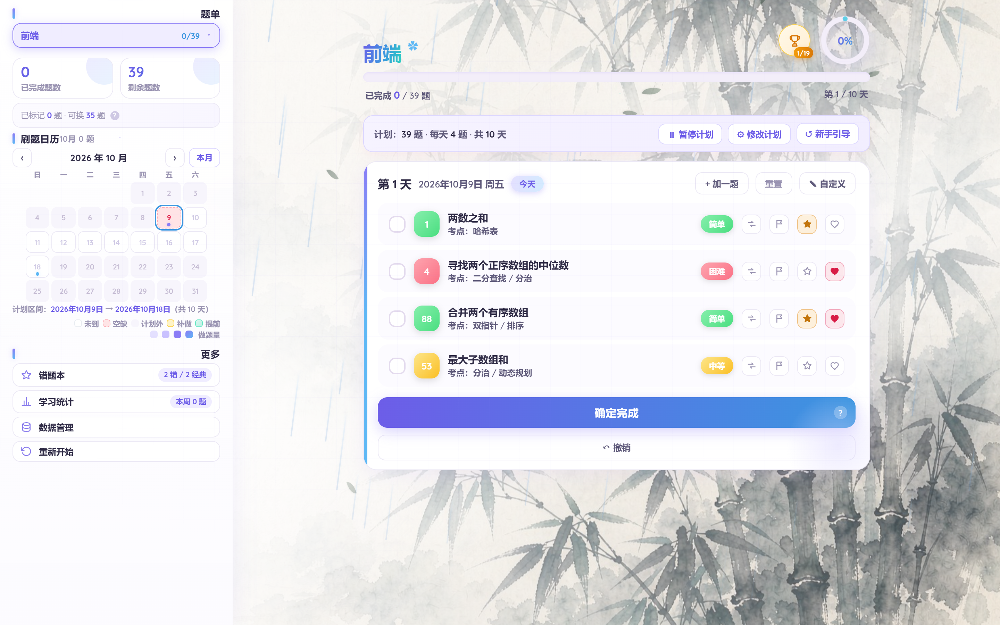
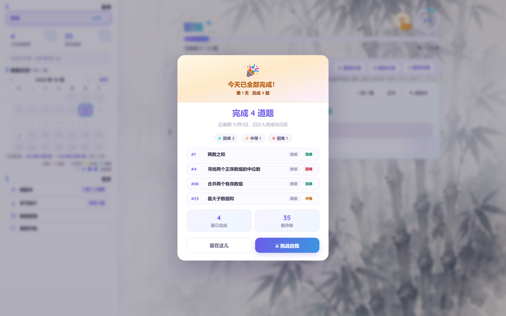
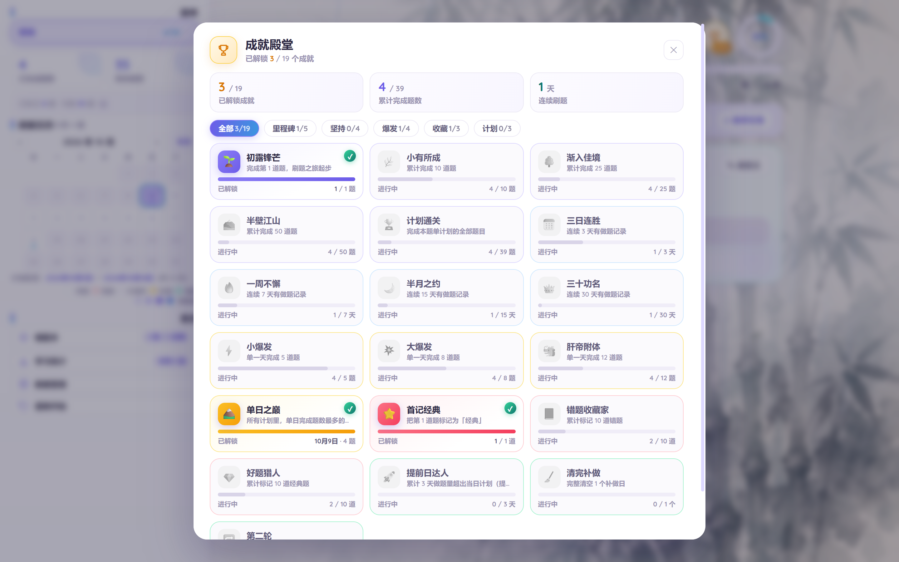
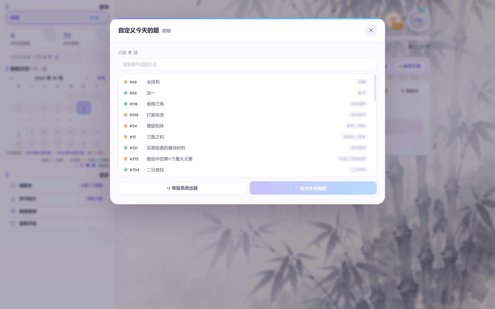
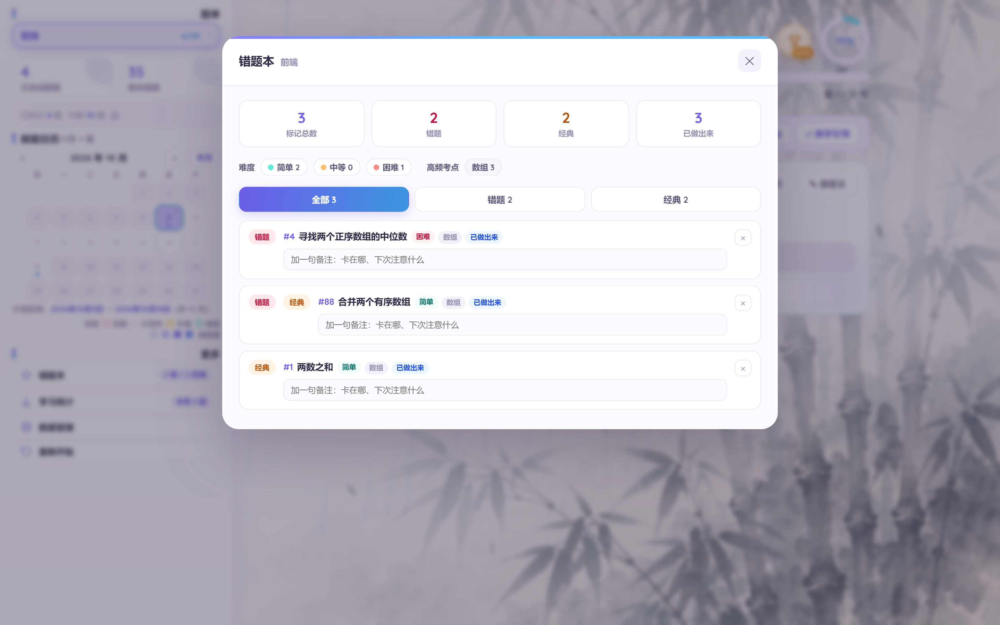

# 力扣刷题看板 ✧

> 一个 **Vibe Coding** 作品 —— 纯 HTML / CSS / JavaScript 前端 + Python 标准库本地服务，  
> **运行时零第三方依赖**，Windows 双击 bat 就能跑。全程由 AI Agent（WorkBuddy）与人协作完成。



每天打开看一眼：**今天该做哪几道**、做完打勾、没做完的题留在今天，日历记录你的坚持。

---

## ✨ 功能

| <br />           | <br />                             |
| ---------------- | ---------------------------------- |
| 📅 **动态计划**      | 总题数 / 每天题数随手改，天数自动重算               |
| ✅ **当天题板**       | 打勾即记录，没做完的题留在今天；换题、自定义做哪几道都行       |
| 🔄 **跨天自动结算**    | 到点自动翻篇：没做的顺延或进补做日，进度天数自动伸缩         |
| 🏆 **成就 + 结算页**  | 19 个成就 5 类；提交后弹结算页：做了哪几道、难度分布、累计进度 |
| 📖 **多题单**       | 自带 LeetCode 100，可粘贴力扣题单链接导入        |
| ⭐ **错题本**        | 标记经典 / 错题 + 备注，统计难度与考点             |
| 📊 **统计 + 热力日历** | 连续天数、难度分布、单日纪录，悬停看当天做了哪几道          |
| 🎨 **水墨氛围**      | 竹林背景 + 细雨 + 竹叶飘落，AI 生成插画           |

---

## 📸 主要页面

**提交后的结算页** —— 做完今天的题点「确定完成」，弹出：当天做了哪几道、难度分布、累计进度。



**成就殿堂** —— 19 个成就分 5 类，做到哪个解锁哪个。



**自定义选题** —— 当天想换着做 / 加题 / 指定做哪几道都行。



**错题本** —— 标记经典或错题 + 备注，按难度和考点统计。



---

## 🚀 使用

**要求：Python 3.8+**（[官网下载](https://www.python.org/downloads/)，安装时勾选 *Add to PATH*）。  
**不需要** `pip install` 任何东西 —— 只用 Python 标准库。

### Windows：双击（最省事）

下载解压后，双击 **`start/打开看板.bat`**，浏览器会自动打开。

改了 `server.py` 之后，双击 **`start/重启看板.bat`** 重启服务 —— 它会先停掉旧服务再拉起（「打开看板」在服务已经跑着时只会开个浏览器标签页，不会重启）。

- bat 会按顺序找 Python：`python` → `python3` → `py -3` → 标准安装位置（`%LOCALAPPDATA%\Programs\Python\…`）→ 项目内 `python\` 目录
- 所以装 Python 时没勾 *Add to PATH* 也能跑（只要装在标准位置）
- 没装 Python 也不会闪退没反应：会明确提示并给出安装地址
- 服务**静默后台启动**，不留黑框；想退出在任务管理器结束 `python` 即可

### 命令行（macOS / Linux / 任何平台）

```bash
git clone https://github.com/qiuyun71/LeetCode-Dashboard.git && cd LeetCode-Dashboard

python3 start/start.py   # 起服务 + 自动开浏览器
# 或者
./start/start.sh         # 同上（macOS / Linux）

python3 server.py        # 只起服务，浏览器访问 http://127.0.0.1:8765
```

| 环境变量        | 说明     | 默认            |
| ----------- | ------ | ------------- |
| `LEET_PORT` | 服务端口   | `8765`        |
| `LEET_PLAN` | 数据文件路径 | `./plan.json` |

### 数据说明

**所有数据都在** **`plan.json`** **这一个文件里**，纯本地、不联网、不上传，且已在 `.gitignore` 里 —— 别把自己的刷题进度传到公开仓库。

- 首次启动时没有 `plan.json`，服务会**自动生成**一份带 LeetCode 100 的默认题库，打开就能用
- 想备份进度，复制 `plan.json` 即可；仓库里另有 `plan.example.json` 数据模板

---

## 📁 结构速览

```
server.py / ui.html / app.js   服务与界面（零依赖，改完刷新即生效）
seed_lc100.py                  LeetCode 100 题库（重建用）
start/                         打开看板.bat / 重启看板.bat / start.py / start.sh / toast.ps1
assets/ docs/ favicon.svg      背景图 / 截图 / 图标
plan.example.json              数据模板
```

---

## 🤖 Vibe Coding · 本项目使用的智能体与模型

本项目是一个 **Vibe Coding** 作品：全程由 **WorkBuddy**（AI Agent 工作台）驱动 ——  
需求、功能实现、UI 迭代、Bug 排查均由 Agent 执行并验证，人负责提需求与验收。  
先后调用过 LongCat-2.5-Preview、hy4-preview、space-bunny、step-5-preview 等模型，
具体用量由本机的 TokenTracker 记录。

从零到可用：**零第三方依赖、零构建工具、零部署**，一个 Python 文件就能跑起来。

---
